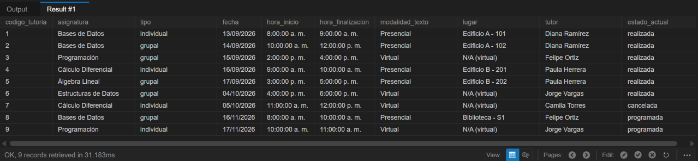
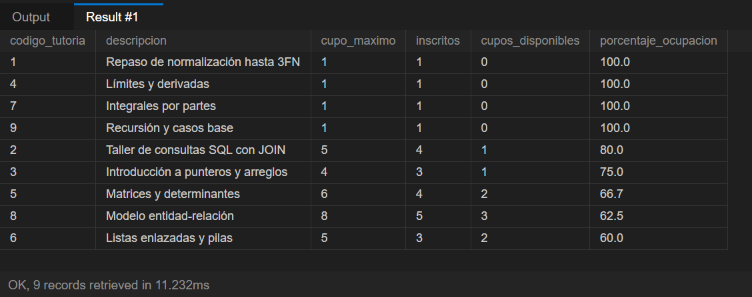
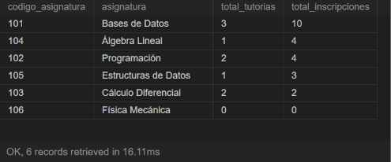
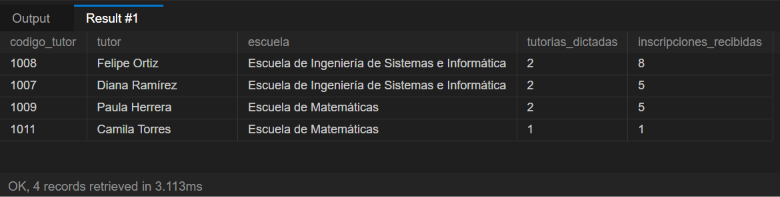
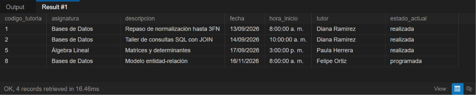
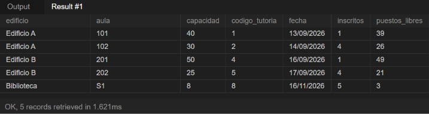
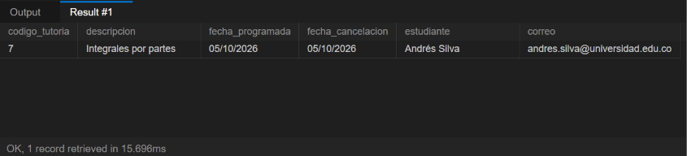
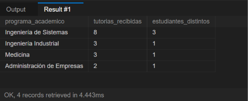
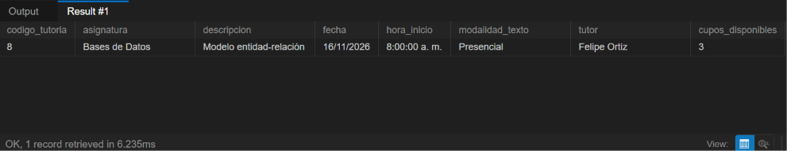
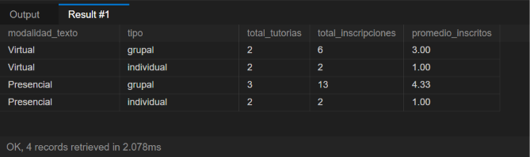

# Consultas - SQL
Convenciones: `modalidad = TRUE` es presencial y `tutor.estado = TRUE` es activo. Las consultas usan la vista `v_tutoria_estado_actual` para conocer el estado vigente de cada tutoría. Antes de ejecutarlas, seleccionar la base de datos:

```sql
USE tutorhub;
```

---

## 1. Agenda de tutorías

lista cada tutoría con su asignatura, tutor, modalidad, lugar y estado actual.

```sql
SELECT t.codigo_tutoria,
       a.nombre                                   AS asignatura,
       t.tipo,
       t.fecha,
       t.hora_inicio,
       t.hora_finalizacion,
       CASE WHEN t.modalidad THEN 'Presencial' ELSE 'Virtual' END   AS modalidad_texto,
       COALESCE(CONCAT(t.edificio, ' - ', t.aula), 'N/A (virtual)') AS lugar,
       CONCAT(p.nombre, ' ', p.apellido)          AS tutor,
       v.estado                                   AS estado_actual
FROM tutoria t
JOIN asignatura a              ON a.codigo_asignatura = t.codigo_asignatura
JOIN persona p                 ON p.codigo            = t.codigo_tutor
JOIN v_tutoria_estado_actual v ON v.codigo_tutoria    = t.codigo_tutoria
ORDER BY t.fecha, t.hora_inicio;
```


---

## 2. Ocupación de cupos por tutoría

Compara inscritos contra el cupo máximo y calcular cupos disponibles y porcentaje de ocupación.

```sql
SELECT t.codigo_tutoria,
       t.descripcion,
       t.cantidad_maxima_estudiantes                               AS cupo_maximo,
       COUNT(et.codigo_estudiante)                                 AS inscritos,
       t.cantidad_maxima_estudiantes - COUNT(et.codigo_estudiante) AS cupos_disponibles,
       ROUND(100.0 * COUNT(et.codigo_estudiante)
             / t.cantidad_maxima_estudiantes, 1)                   AS porcentaje_ocupacion
FROM tutoria t
LEFT JOIN estudiante_tutoria et ON et.codigo_tutoria = t.codigo_tutoria
GROUP BY t.codigo_tutoria, t.descripcion, t.cantidad_maxima_estudiantes
ORDER BY porcentaje_ocupacion DESC, t.codigo_tutoria;
```



## 3. Asignaturas más solicitadas

Dice cuantas tutorías y cuantas inscripciones tiene cada asignatura
.
```sql
SELECT a.codigo_asignatura,
       a.nombre                         AS asignatura,
       COUNT(DISTINCT t.codigo_tutoria) AS total_tutorias,
       COUNT(et.codigo_estudiante)      AS total_inscripciones
FROM asignatura a
LEFT JOIN tutoria t             ON t.codigo_asignatura = a.codigo_asignatura
LEFT JOIN estudiante_tutoria et ON et.codigo_tutoria   = t.codigo_tutoria
GROUP BY a.codigo_asignatura, a.nombre
ORDER BY total_inscripciones DESC, a.nombre;
```


---

## 4. Carga de trabajo de tutores

Mide cuantas tutorías tiene cada tutor y a cuantos estudiantes atiende en total.

```sql
SELECT tu.codigo_tutor,
       CONCAT(p.nombre, ' ', p.apellido) AS tutor,
       tu.escuela,
       COUNT(DISTINCT t.codigo_tutoria)  AS tutorias_dictadas,
       COUNT(et.codigo_estudiante)       AS inscripciones_recibidas
FROM tutor tu
JOIN persona p                  ON p.codigo          = tu.codigo_tutor
LEFT JOIN tutoria t             ON t.codigo_tutor    = tu.codigo_tutor
LEFT JOIN estudiante_tutoria et ON et.codigo_tutoria = t.codigo_tutoria
WHERE tu.estado = TRUE
GROUP BY tu.codigo_tutor, p.nombre, p.apellido, tu.escuela
ORDER BY tutorias_dictadas DESC, inscripciones_recibidas DESC;
```


---

## 5. Historial de tutorías de un estudiante

Muestra el historial de tutorías de un estudiante

```sql
SELECT t.codigo_tutoria,
       a.nombre                           AS asignatura,
       t.descripcion,
       t.fecha,
       t.hora_inicio,
       CONCAT(pt.nombre, ' ', pt.apellido) AS tutor,
       v.estado                           AS estado_actual
FROM estudiante_tutoria et
JOIN tutoria t                 ON t.codigo_tutoria    = et.codigo_tutoria
JOIN asignatura a              ON a.codigo_asignatura = t.codigo_asignatura
JOIN persona pt                ON pt.codigo           = t.codigo_tutor
JOIN v_tutoria_estado_actual v ON v.codigo_tutoria    = t.codigo_tutoria
WHERE et.codigo_estudiante = 1001
ORDER BY t.fecha, t.hora_inicio;
```


---

## 6. Uso de aulas en tutorías presenciales

**Propósito:** verificar que los inscritos no superen la capacidad física del aula y ver los puestos libres.

```sql
SELECT l.edificio,
       l.aula,
       l.capacidad,
       t.codigo_tutoria,
       t.fecha,
       COUNT(et.codigo_estudiante)               AS inscritos,
       l.capacidad - COUNT(et.codigo_estudiante) AS puestos_libres
FROM tutoria t
JOIN lugar l                    ON l.edificio = t.edificio AND l.aula = t.aula
LEFT JOIN estudiante_tutoria et ON et.codigo_tutoria = t.codigo_tutoria
WHERE t.modalidad = TRUE
GROUP BY l.edificio, l.aula, l.capacidad, t.codigo_tutoria, t.fecha
ORDER BY t.fecha;
```


---

## 7. Tutorías canceladas y correos de estudiantes afectados

Muestra los correos de los estudiantes afectados por la cancelación de una tutoría. Ademas, muestra la fecha de cancelación.

```sql
SELECT t.codigo_tutoria,
       t.descripcion,
       t.fecha                             AS fecha_programada,
       v.fecha_desde                       AS fecha_cancelacion,
       CONCAT(pe.nombre, ' ', pe.apellido) AS estudiante,
       pe.correo
FROM v_tutoria_estado_actual v
JOIN tutoria t             ON t.codigo_tutoria  = v.codigo_tutoria
JOIN estudiante_tutoria et ON et.codigo_tutoria = t.codigo_tutoria
JOIN persona pe            ON pe.codigo         = et.codigo_estudiante
WHERE v.estado = 'cancelada'
ORDER BY t.codigo_tutoria, pe.apellido;
```


---

## 8. Participación por programa académico

estadística de asistencia: cuántas tutorías realizadas recibió cada programa y cuántos estudiantes distintos participaron.

```sql
SELECT es.programa_academico,
       COUNT(*)                             AS tutorias_recibidas,
       COUNT(DISTINCT es.codigo_estudiante) AS estudiantes_distintos
FROM estudiante_tutoria et
JOIN estudiante es             ON es.codigo_estudiante = et.codigo_estudiante
JOIN v_tutoria_estado_actual v ON v.codigo_tutoria     = et.codigo_tutoria
WHERE v.estado = 'realizada'
GROUP BY es.programa_academico
ORDER BY tutorias_recibidas DESC;
```


---

## 9. Tutorías programadas con cupos disponibles

Muestra las tutorías disponibles para inscribirse.

```sql
SELECT t.codigo_tutoria,
       a.nombre                        AS asignatura,
       t.descripcion,
       t.fecha,
       t.hora_inicio,
       CASE WHEN t.modalidad THEN 'Presencial' ELSE 'Virtual' END AS modalidad_texto,
       CONCAT(p.nombre, ' ', p.apellido) AS tutor,
       t.cantidad_maxima_estudiantes - COUNT(et.codigo_estudiante) AS cupos_disponibles
FROM tutoria t
JOIN asignatura a               ON a.codigo_asignatura = t.codigo_asignatura
JOIN persona p                  ON p.codigo            = t.codigo_tutor
JOIN v_tutoria_estado_actual v  ON v.codigo_tutoria    = t.codigo_tutoria
LEFT JOIN estudiante_tutoria et ON et.codigo_tutoria   = t.codigo_tutoria
WHERE v.estado = 'programada'
GROUP BY t.codigo_tutoria, a.nombre, t.descripcion, t.fecha, t.hora_inicio,
         t.modalidad, p.nombre, p.apellido, t.cantidad_maxima_estudiantes
HAVING COUNT(et.codigo_estudiante) < t.cantidad_maxima_estudiantes
ORDER BY t.fecha, t.hora_inicio;
```


---

## 10. Resumen por modalidad y tipo de tutoría

Compara tutorías presenciales vs. virtuales e individuales vs. grupales, con el promedio de estudiantes por sesión.

```sql
SELECT CASE WHEN t.modalidad THEN 'Presencial' ELSE 'Virtual' END AS modalidad_texto,
       t.tipo,
       COUNT(DISTINCT t.codigo_tutoria)                  AS total_tutorias,
       COUNT(et.codigo_estudiante)                       AS total_inscripciones,
       ROUND(COUNT(et.codigo_estudiante)
             / COUNT(DISTINCT t.codigo_tutoria), 2)      AS promedio_inscritos
FROM tutoria t
LEFT JOIN estudiante_tutoria et ON et.codigo_tutoria = t.codigo_tutoria
GROUP BY t.modalidad, t.tipo
ORDER BY t.modalidad, t.tipo;
```

