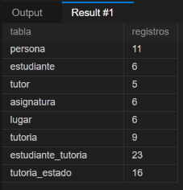

# TutorHUB – Carga de Datos (MySQL)

Script de inserción de datos de prueba

## Resumen de registros

| Tabla | Registros |
|-------|-----------|
| persona | 11 |
| estudiante | 6 |
| tutor | 5 |
| asignatura | 6 |
| lugar | 6 |
| tutoria | 9 |
| estudiante_tutoria | 23 |
| tutoria_estado | 16 |

Notas sobre los datos:
- Toda tutoría tiene al menos un estudiante inscrito.
- Las tutorías presenciales tienen lugar; las virtuales no (`NULL`).
- La asignatura *Física Mecánica* y el lugar *Edificio C / 101* no tienen tutorías, para probar consultas con `LEFT JOIN`.
- El tutor `1010` está inactivo y la tutoría `7` está cancelada.

## Script

```sql
USE tutorhub;

INSERT INTO persona (codigo, correo, nombre, apellido, telefono) VALUES
(1001, 'juan.perez@universidad.edu.co',     'Juan',    'Pérez',    '3001234567'),
(1002, 'maria.gomez@universidad.edu.co',    'María',   'Gómez',    '3012345678'),
(1003, 'carlos.rojas@universidad.edu.co',   'Carlos',  'Rojas',    '3023456789'),
(1004, 'laura.martinez@universidad.edu.co', 'Laura',   'Martínez', '3034567890'),
(1005, 'andres.silva@universidad.edu.co',   'Andrés',  'Silva',    '3045678901'),
(1006, 'sofia.castro@universidad.edu.co',   'Sofía',   'Castro',   '3056789012'),
(1007, 'diana.ramirez@universidad.edu.co',  'Diana',   'Ramírez',  '3101112233'),
(1008, 'felipe.ortiz@universidad.edu.co',   'Felipe',  'Ortiz',    '3112223344'),
(1009, 'paula.herrera@universidad.edu.co',  'Paula',   'Herrera',  '3123334455'),
(1010, 'jorge.vargas@universidad.edu.co',   'Jorge',   'Vargas',   '3134445566'),
(1011, 'camila.torres@universidad.edu.co',  'Camila',  'Torres',   '3145556677');

INSERT INTO estudiante (codigo_estudiante, programa_academico, semestre) VALUES
(1001, 'Ingeniería de Sistemas',      5),
(1002, 'Ingeniería de Sistemas',      3),
(1003, 'Ingeniería Industrial',       4),
(1004, 'Medicina',                    2),
(1005, 'Administración de Empresas',  6),
(1006, 'Ingeniería de Sistemas',      7);

INSERT INTO tutor (codigo_tutor, escuela, estado) VALUES
(1007, 'Escuela de Ingeniería de Sistemas e Informática', TRUE),
(1008, 'Escuela de Ingeniería de Sistemas e Informática', TRUE),
(1009, 'Escuela de Matemáticas',                          TRUE),
(1010, 'Escuela de Ingeniería de Sistemas e Informática', FALSE),
(1011, 'Escuela de Matemáticas',                          TRUE);

INSERT INTO asignatura (codigo_asignatura, nombre) VALUES
(101, 'Bases de Datos'),
(102, 'Programación'),
(103, 'Cálculo Diferencial'),
(104, 'Álgebra Lineal'),
(105, 'Estructuras de Datos'),
(106, 'Física Mecánica');

INSERT INTO lugar (edificio, aula, capacidad) VALUES
('Edificio A',  '101', 40),
('Edificio A',  '102', 30),
('Edificio B',  '201', 50),
('Edificio B',  '202', 25),
('Edificio C',  '101', 35),
('Biblioteca',  'S1',   8);

INSERT INTO tutoria
(codigo_tutoria, tipo, descripcion, cantidad_maxima_estudiantes, fecha, hora_inicio, hora_finalizacion,
 modalidad, observaciones, codigo_asignatura, edificio, aula, codigo_tutor) VALUES
(1, 'individual', 'Repaso de normalización hasta 3FN',        1, '2026-09-14', '08:00:00', '09:00:00', TRUE,
    'Traer ejercicios del taller 2',            101, 'Edificio A', '101', 1007),
(2, 'grupal',     'Taller de consultas SQL con JOIN',         5, '2026-09-15', '10:00:00', '12:00:00', TRUE,
    'Portátil con MySQL instalado',             101, 'Edificio A', '102', 1007),
(3, 'grupal',     'Introducción a punteros y arreglos',       4, '2026-09-16', '14:00:00', '16:00:00', FALSE,
    'Enlace de Microsoft Teams por correo',     102, NULL,         NULL,  1008),
(4, 'individual', 'Límites y derivadas',                      1, '2026-09-17', '09:00:00', '10:00:00', TRUE,
    'Resolver guía previa',                     103, 'Edificio B', '201', 1009),
(5, 'grupal',     'Matrices y determinantes',                 6, '2026-09-18', '15:00:00', '17:00:00', TRUE,
    'Repaso para el parcial',                   104, 'Edificio B', '202', 1009),
(6, 'grupal',     'Listas enlazadas y pilas',                 5, '2026-10-05', '16:00:00', '18:00:00', FALSE,
    'Sesión por Zoom',                          105, NULL,         NULL,  1010),
(7, 'individual', 'Integrales por partes',                    1, '2026-10-06', '11:00:00', '12:00:00', FALSE,
    'Tutor no disponible',                      103, NULL,         NULL,  1011),
(8, 'grupal',     'Modelo entidad-relación',                  8, '2026-11-17', '08:00:00', '10:00:00', TRUE,
    'Sala de estudio de la biblioteca',         101, 'Biblioteca', 'S1',  1008),
(9, 'individual', 'Recursión y casos base',                   1, '2026-11-18', '10:00:00', '11:00:00', FALSE,
    'Sesión por Google Meet',                   102, NULL,         NULL,  1010);

INSERT INTO estudiante_tutoria (codigo_estudiante, codigo_tutoria) VALUES
-- Tutoría 1 (individual)
(1001, 1),
-- Tutoría 2 (grupal, cupo 5)
(1001, 2), (1002, 2), (1003, 2), (1004, 2),
-- Tutoría 3 (grupal, cupo 4)
(1002, 3), (1003, 3), (1005, 3),
-- Tutoría 4 (individual)
(1004, 4),
-- Tutoría 5 (grupal, cupo 6)
(1001, 5), (1002, 5), (1005, 5), (1006, 5),
-- Tutoría 6 (grupal, cupo 5)
(1003, 6), (1004, 6), (1006, 6),
-- Tutoría 7 (individual, cancelada)
(1005, 7),
-- Tutoría 8 (grupal, cupo 8)
(1001, 8), (1002, 8), (1003, 8), (1004, 8), (1006, 8),
-- Tutoría 9 (individual)
(1006, 9);

INSERT INTO tutoria_estado (codigo_tutoria, fecha_desde, estado) VALUES
(1, '2026-09-01 08:00:00', 'programada'),
(1, '2026-09-14 09:05:00', 'realizada'),
(2, '2026-09-02 09:30:00', 'programada'),
(2, '2026-09-15 12:05:00', 'realizada'),
(3, '2026-09-03 10:00:00', 'programada'),
(3, '2026-09-16 16:05:00', 'realizada'),
(4, '2026-09-04 11:15:00', 'programada'),
(4, '2026-09-17 10:05:00', 'realizada'),
(5, '2026-09-05 14:00:00', 'programada'),
(5, '2026-09-18 17:05:00', 'realizada'),
(6, '2026-09-20 08:45:00', 'programada'),
(6, '2026-10-05 18:05:00', 'realizada'),
(7, '2026-09-25 13:20:00', 'programada'),
(7, '2026-10-05 20:00:00', 'cancelada'),
(8, '2026-11-01 09:00:00', 'programada'),
(9, '2026-11-02 15:30:00', 'programada');
```

### Verificación rápida

```sql
SELECT 'persona' AS tabla, COUNT(*) AS registros FROM persona
UNION ALL SELECT 'estudiante',         COUNT(*) FROM estudiante
UNION ALL SELECT 'tutor',              COUNT(*) FROM tutor
UNION ALL SELECT 'asignatura',         COUNT(*) FROM asignatura
UNION ALL SELECT 'lugar',              COUNT(*) FROM lugar
UNION ALL SELECT 'tutoria',            COUNT(*) FROM tutoria
UNION ALL SELECT 'estudiante_tutoria', COUNT(*) FROM estudiante_tutoria
UNION ALL SELECT 'tutoria_estado',     COUNT(*) FROM tutoria_estado;
```

